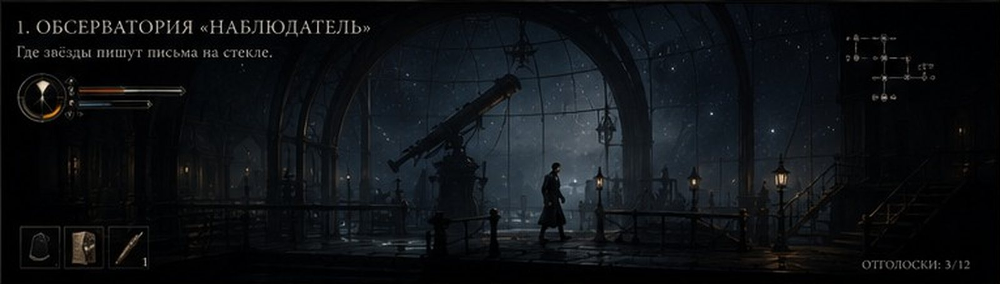
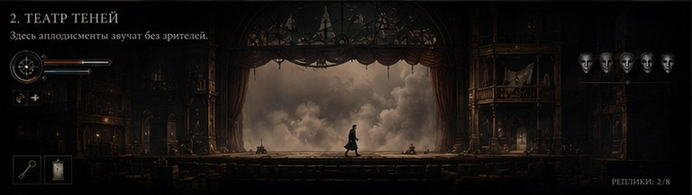
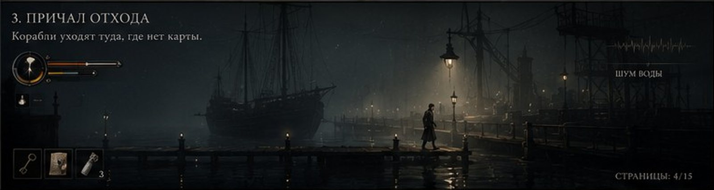
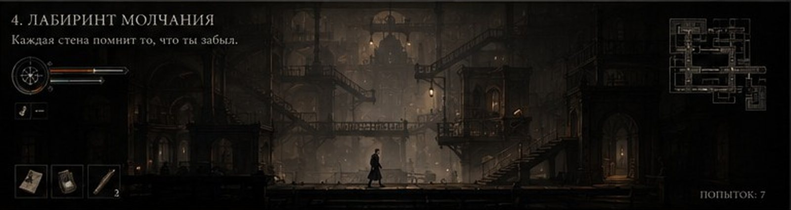
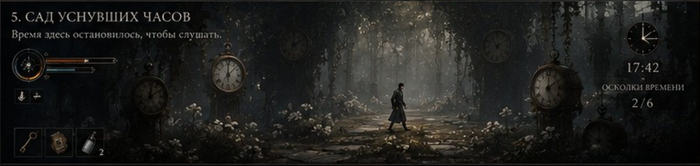
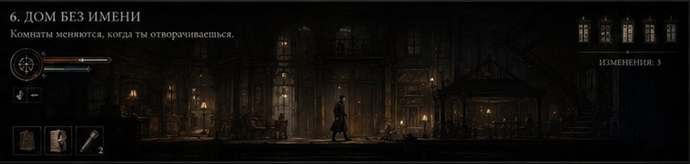
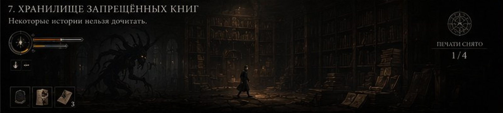
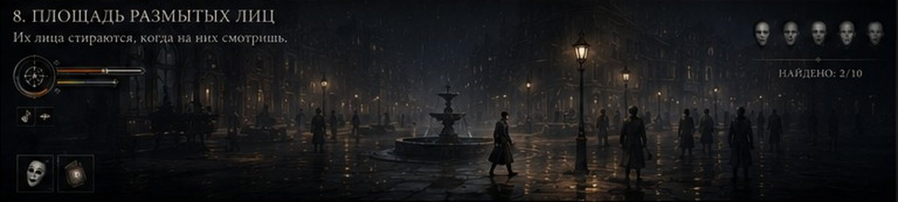
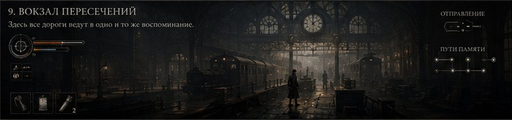
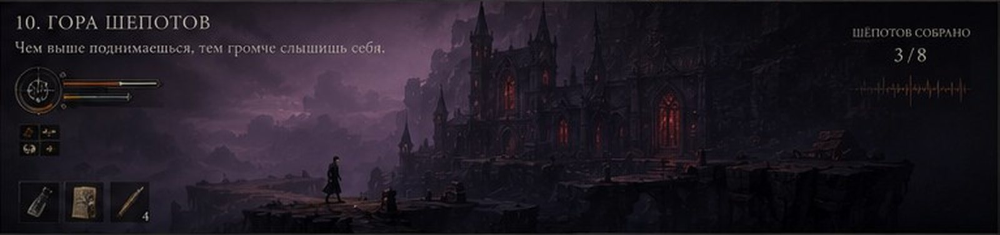

# «Чёрная капля» — Визуальный стиль и уровень качества

> Как я понимаю планку «картинка и анимация уровня **Inside** и **Little Nightmares**»: что именно взять у этих игр, что из этого следует для производства и как довести присланные макеты до такого уровня.

---

## 1. Что значит «уровень Inside / Little Nightmares»

Это не «красивые картинки». Это набор конкретных решений, которые можно проверить.

### Что берём у Inside (Playdead)
- **Сдержанность.** Мало цветов, мало деталей в игровой плоскости, много воздуха. Каждый кадр читается за полсекунды.
- **Непрерывная камера.** Почти нет склеек: мир — один длинный кадр, по которому камера едет, отстаёт, догоняет.
- **Силуэт героя — самое читаемое пятно в кадре.** Всегда, даже когда герой занимает 5% экрана.
- **Физичность анимации.** Мальчик не «проигрывает анимацию», а живёт в теле: переносит вес, спотыкается, тормозит руками, колеблется на краю, тяжело дышит после бега. Сотни контекстных анимаций и процедурное смешивание.
- **Фон рассказывает.** Самые важные события часто происходят на заднем плане и не объясняются.
- **Свет как драматургия.** Конусы света — опасность, тьма — укрытие. Туман работает как атмосферная перспектива.
- **Звук первичен.** Тишина, дыхание, шаги по разным поверхностям.

### Что берём у Little Nightmares (Tarsier)
- **Ощущение диорамы.** Мир как кукольный дом в разрезе, с малой глубиной резкости и лёгким эффектом миниатюры.
- **Гротеск.** Существа с искажёнными пропорциями, тактильными материалами (кожа, ткань, жир, фарфор) и узнаваемой пластикой.
- **Тёплое против холодного.** Тёплые лампы внутри, холодный лунный свет снаружи.
- **Уязвимость героя.** Он слабее всего вокруг, поэтому прячется, а не дерётся.
- **«Ручная» камера.** Едва заметное покачивание, будто кто-то держит её в руках. *(У нас это сюжетно оправдано: камеру «держит» Вивиан.)*

### Что добавляем мы
- **Живописная поверхность викторианской гравюры и масла.** Мазок и штриховка в текстурах, лёгкий холст в пост-обработке. Это продолжение стиля макетов.
- **Цветовой сценарий по ступеням траура** (раздел 4).
- **Психоделия через викторианскую оптику** (раздел 6), а не через «кислотные» шейдеры 60-х.
- **Камера как персонаж.** Её поведение подчинено сюжету: это взгляд Вивиан.

---

## 2. Разбор присланных макетов

Макеты (`docs/mockups/`) — сильная основа настроения. Ниже то, что сохраняем как есть, и то, что нужно довести для продакшена.

| Глава | Макет |
|---|---|
| 1. Обсерватория «Наблюдатель» |  |
| 2. Театр теней |  |
| 3. Причал отхода |  |
| 4. Лабиринт молчания |  |
| 5. Сад уснувших часов |  |
| 6. Дом без имени |  |
| 7. Хранилище запрещённых книг |  |
| 8. Площадь размытых лиц |  |
| 9. Вокзал пересечений |  |
| 10. Гора шепотов |  |

### ✅ Что работает и остаётся
- **Масштаб.** Маленький человек в огромной архитектуре — правильная интонация.
- **Палитры по локациям.** Синий купол, сепия театра, бирюза причала, лиловая гора уже складываются в цветовой сценарий.
- **Мотивированные источники света.** Газовые рожки, фонари, витражи.
- **Подписи глав.** Они уже работают на двойное прочтение (см. сценарий).
- **Язык интерфейса.** Тонкие золотистые линии, капители с засечками, круглый медальон. Красиво и в эпохе.
- **Панорамный формат 4:1.** Это готовая раскладка уровня по горизонтали, удобная для планирования параллакса и маршрута.

### 🔧 Что нужно довести до уровня Inside / LN

| Проблема в макете | Почему это важно | Решение для продакшена |
|---|---|---|
| **Герой теряется** (5–7% высоты кадра, сливается с фоном: Лабиринт, Хранилище) | Игрок должен мгновенно находить героя | В игровом кадре герой занимает **10–14% высоты** (в Inside около 12%), 5–7% только в обзорных планах. Тонкий контровой свет по силуэту, тон фона за героем всегда на 2–3 ступени светлее или темнее |
| **Шум деталей** (характерная для генерации «каша» мелких элементов в игровой плоскости) | Глаз не понимает, где пол, где опасность, где путь | **Иерархия детализации:** игровая плоскость чистая и обобщённая, максимум деталей в среднем фоне, дальний фон упрощён туманом. Правило: в игровой плоскости не больше 3 ключевых форм на экран |
| **Неясная линия пола** | Платформер требует ясности опор | Каждая опора читается по силуэту и по свету: верхняя кромка поверхности всегда имеет светлый блик |
| **Много источников света одинаковой силы** | Плоская картинка, нет драматургии | Один **ключевой** источник на сцену, остальные подчинённые. Свет ведёт к цели |
| **HUD всегда на экране и довольно тяжёлый** | В Inside нет HUD вообще. Постоянный интерфейс разрушает кинематографичность | **Адаптивный HUD** (раздел 8): появляется по событию и растворяется |
| **Герой выглядит по-разному** (кепка на вокзале, разная длина пальто) | Персонаж должен быть узнаваем по силуэту | Утверждённый модельный лист (раздел 7) |
| **События на фоне почти не читаются** | Фон — главный инструмент повествования | Фоновые сцены ставятся отдельно: контраст, свет, ритм движения, чтобы их замечали, но не путали с игровой плоскостью |
| **Передний план редко используется** | Глубина — главное преимущество 2.5D | Передний план — тёмные расфокусированные силуэты (рамы, спинки кресел, перила). В нём же иногда угадывается силуэт Вивиан |

---

## 3. Визуальные принципы (столпы)

1. **«Гравюра, которая дышит».** Каждый статичный кадр выглядит как иллюстрация к роману 1880-х, но в нём всё время что-то движется: пыль, дождь, пламя, ткань, далёкие фигуры.
2. **«Один свет — одна правда».** У каждой сцены один главный источник. Куда падает свет, туда смотрит игрок.
3. **«Герой — самое читаемое пятно».** Проверка: уменьшить кадр до 64 пикселей по ширине. Герой должен находиться.
4. **«Фон — это сцена».** Задний план поставлен как спектакль: у него есть режиссура, время, кульминация.
5. **«Психоделия — оптическая».** Искажения выглядят как работа линзы, калейдоскопа, волшебного фонаря, а не как цифровой глитч.
6. **«Цвет — это ступень траура».** Цвет меняется по сюжету, а не по прихоти локации.

---

## 4. Цветовой сценарий (по ступеням викторианского траура)

Палитра всей игры движется от **глубокого траура** (матовый чёрный, креп) через **второй траур** (пепел, сажа) к **полутрауру** (серый, лиловый, мов) и к **свету**. Это одновременно и структура игры, и спрятанная подсказка: мы смотрим глазами вдовы.

| Глава | Ступень | Основа | Средний тон | Свет | Акцент |
|---|---|---|---|---|---|
| Пролог, 1 | Глубокий траур | `#0B0F1A` ночь-индиго | `#1C2333` | `#C9D3E0` звёздный | `#E0A050` газ |
| 2 | Глубокий траур | `#1A120D` | `#3B2A1E` | `#D8C7A6` дым | `#7A1E1E` бархат |
| 3 | Глубокий траур | `#0A1414` | `#1E2E2E` | `#9FB3AE` туман | `#E8C070` фонарь |
| 4 | Второй траур | `#141210` | `#2B2722` | `#8A7F70` пепел | `#C98A3A` лампа |
| 5 | Второй траур | `#0E120E` | `#233021` | `#E8E4D8` кость | `#6E8F7A` ярь-медянка |
| 6 | Второй траур | `#0D0C0B` | `#2F3A2A` шееле-зелёный | `#BFAE8A` | `#D9A441` свеча |
| 7 | Обычный траур | `#070707` | `#2A2116` | `#CBB48A` пергамент | `#F2C66D` сало |
| 8 | Обычный траур | `#0A0C10` | `#1D232B` | `#5E6670` мокрый камень | `#F0B860` газ |
| 9 | Обычный траур | `#101214` | `#3A3F44` чугун | `#DCE3E8` пар | `#B3261E` / `#3E8E5A` сигналы |
| 10 | **Полутраур** | `#1A1022` | `#4B2F5C` мовеин | `#9C7FB5` сирень | `#C2291F` витраж |
| 11 | — (эскиз) | `#EDE8DF` бумага | `#8D8A84` карандаш | — | `#8B1A1A` шаль |
| 12 | — (сцена) | `#120B0A` | `#9E1B32` алый Джульетты | `#F4E3C1` рампа | `#9FB8D0` Гаситель |
| 13 | Свет | `#3A3632` сажа | `#C9C6BF` облака | `#F6D88A` солнце | `#050505` капля |
| Эпилог | Полутраур → жизнь | `#EFE9DD` утро | `#B7A6C9` лаванда | `#FFF4DC` | `#A8C49A` первая зелень |

**Правило насыщенности.** До гл. 10 насыщенность выше 35% допускается только у акцента и только в одном пятне на кадр. Первый «по-настоящему цветной» кадр игры — лиловая гора.

---

## 5. Свет и атмосфера

- **Ключ — мотивированный.** Луна, газ, свеча, витраж, рампа. Никакого «света ниоткуда».
- **Объёмный туман** во всех сценах: он отделяет планы и даёт лучи.
- **Пыль в лучах** — обязательная деталь каждого интерьера.
- **Мокрые поверхности** (причал, площадь, вокзал) с отражениями фонарей; в лужах видно лица (механика гл. 8).
- **Контровой свет на герое** всегда, тонкая кромка 1–2 пикселя на 1080p.
- **Тьма Гасителя** — не просто отсутствие света, а **смыв**: живописная текстура стекает, как мокрая краска, обнажая чернильную пустоту со звёздной пылью. Это фирменный эффект игры.

---

## 6. Психоделия через викторианскую оптику

Все искажения реальности в игре выглядят как работа оптических приборов XIX века. Это делает психоделию уникальной и исторически укоренённой.

| Прибор / явление | Визуальный эффект | Где используется |
|---|---|---|
| **Калейдоскоп** (1816) | Шестилучевая симметрия, сборка мира из осколков | Переходы между главами, флаконы лауданума |
| **Волшебный фонарь, фантасмагория** | Проекции с виньеткой, дрожащий луч, проекция на дым | Отголоски, аппарат доктора, лицо на облаках в гл. 12 |
| **Зоотроп / праксиноскоп** | Зацикленное движение, видимое через прорези | Окна вагонов в гл. 9: чужие жизни крутятся по кругу |
| **Стереоскоп** | Двоение изображения, сдвиг двух кадров | Сомнение, ложное воспоминание, двойник на «Пенелопе» |
| **«Призрак Пеппера»** | Полупрозрачное отражение на наклонном стекле | Гл. 2, отголоски |
| **Спиритическая фотография** | Двойная экспозиция, марлевая «эктоплазма» | Свадьба и отпевание одновременно в гл. 10, материя памяти |
| **Мовеин, фуксин** (1856–59) | Кислотные анилиновые цвета, вспыхивающие в сепии | Эффект лауданума, Гора шепотов |
| **Долгая выдержка** | Размытие живых, резкость неподвижного | Фотокарточка, лица в гл. 8 |
| **Камера-обскура** | Перевёрнутое изображение | Шлифовальная в гл. 1 |

**Лауданум.** Флакон лечит «Нить», но на 60 секунд усиливает «опийный туман»: края кадра уходят в калейдоскоп, цвета сползают в мов и маджента, архитектура «дышит» (медленное масштабирование колонн и арок), звук плывёт, как замедленная пластинка. Чем больше флаконов выпито за главу, тем сильнее эффект.

---

## 7. Персонажи и анимация

### Элиас (герой) — модельный лист
- Рост около 188 см, худой, **сутулится**: плечи чуть вперёд, будто всю жизнь склонялся к окуляру.
- **Длинное тёмно-серое пальто** до середины голени (широкий подол, чтобы ткань работала в анимации), шарф, **без шляпы**: волосы видны всегда (они важны сюжетно, это прядь в броши).
- Лицо почти всегда в тени. Читается силуэт, а не мимика (она помнит силуэт лучше лица).
- **Силуэтная проверка:** узнаваем по контуру в любой из 12 ключевых поз.

### Обязательные качества анимации героя
- **Перенос веса** при каждом старте, остановке, развороте. Никаких мгновенных разворотов на месте.
- **Антиципация и инерция:** перед прыжком присед, после приземления — гашение, иногда на руки.
- **IK рук:** ведёт рукой по стенам, перилам, мебели. Хватается за опору на краю.
- **Look-at головы:** поворачивается к звукам, огням, событиям на фоне. Это главный способ направить внимание игрока без интерфейса.
- **Колебание:** на краю пропасти, у двери, у зеркала он медлит.
- **Дыхание и кашель:** дыхание учащается после бега. Иногда кашель с остановкой.
- **Состояния:** усталость (после погони медленнее), страх (втягивает голову, оглядывается), «призрак» (с гл. 5 лёгкая потеря веса в шагах: меньше пыли, тише).
- **Ткань пальто и шарфа** — симуляция, реагирует на ветер, бег, воду.
- **Idle-детали:** поправляет шарф, смотрит на руки и **изредка коротко оглядывается в камеру**.
- **Объём:** ориентир 400+ контекстных анимаций на героя за игру (мокап плюс ручная доводка плюс процедурный слой).

### Вивиан (гл. 12–13, эпилог)
- Другая пластика: прямая спина актрисы, точные, «поставленные» жесты, юбка (симуляция ткани), корсет ограничивает наклоны.
- Умение «играть роль»: замирает в позе, которую существа принимают за статую.
- Её лицо впервые видно чётко в гл. 12. Это событие, поэтому лицевая анимация должна быть на уровне кинематографического крупного плана.

### Существа: принципы дизайна
Каждое существо — **викторианский предмет или профессия плюс символ горя**. Узнаваемый силуэт, своя «походка» и свой звук.

| Существо | Из чего сделано | Что значит | Пластика | Звук |
|---|---|---|---|---|
| **Гаситель** | Фонарщик, плафон лампы вместо лица | Процедура забвения | Мерная, неторопливая, без спешки | Стеклянная гармоника, «ток-ток», «пф» |
| **Суфлёр** | Суфлёрская будка, меха гармоники, софит | Её голос, который сочиняет ему реплики | Шея выдвигается рывками, голова-луч рыщет | Шёпот множества голосов |
| **Провожающие** | Траурные фигуры с мокрыми платками вместо лиц | Прощания | Машут в ритм волн, разворачиваются целиком | Хлопанье мокрой ткани |
| **Слухачи** | Мебель под пыльными чехлами, слуховые рожки | Молчание, где любой звук опасен | Застывают мебелью, двигаются рывками на звук | Долгий вдох через рожок |
| **Немые** | Наёмные плакальщики с жезлами в крепе | Время, остановленное трауром | Двигаются только при идущем времени | Тишина, шорох крепа |
| **Креп** | Живая траурная ткань | Траур, затягивающий всё | Ползёт, как вода по стеклу | Шорох шёлка |
| **Цензор** | Чернила, гусиные перья, промокашка | Запрет читать и её страх | Длинные шаги, пальцы-перья скребут | Скрип пера, хор задом наперёд |
| **Кондуктор** | Цилиндр, компостер, лицо-гроссбух | Огастес и приличия | Деловитая, механическая | Щёлк компостера |
| **Эхо** | Тень героя с женской походкой | Её отражение в нём | Повторяет движения героя с задержкой | Его шаги её ритмом |

---

## 8. Камера

- **Базовый режим:** боковой вид, герой в левой или правой трети по направлению движения, мягкое опережение.
- **Три дистанции:** обзорная (герой 5–7%, открытие пространства), игровая (10–14%), интимная (20–30%: сцены касания, зеркало, детская).
- **«Ручное» дыхание:** едва заметное покачивание ±0,3°. В гл. 12, когда камерой становится «чужой» взгляд доктора, покачивание исчезает, и кадр становится мёртво-неподвижным.
- **Глубина резкости:** передний план всегда размыт, игровая плоскость резкая, дальний фон смягчён туманом.
- **Без склеек внутри главы.** Переходы между главами — через «портал» (линза, занавес, вода, окно).
- **Три священных нарушения плоскости** за всю игру: влёт в линзу (гл. 1 / демо), **поворот на 180° (гл. 11)**, подъём к куполу и Солнцу (гл. 13). Больше камера никогда не покидает боковую плоскость, поэтому эти моменты так сильно бьют.

### Адаптивный HUD
По макетам HUD сохраняется, но живёт так:
- Появляется на 5 секунд при заголовке главы.
- Брошь и полосы появляются при уроне, при трате «Света» и при нажатии кнопки «показать».
- Инвентарь появляется при подборе и использовании предмета.
- Счётчик главы появляется при находке.
- В остальное время HUD растворяется полностью, и кадр чист, как в Inside.
- **Сюжетно:** HUD — это её вещи (брошь с его волосами, ридикюль). В гл. 12 HUD зеркально перевёрнут, в гл. 13 его нет совсем.

---

## 9. Пост-обработка и эффекты

- Лёгкое **зерно** (ориентир — дагерротип и альбуминовая печать), сильнее в воспоминаниях.
- **Виньетка** мягкая, сильнее в главах распада.
- **Хроматическая аберрация** только в моменты лауданума и на краях линз, никогда постоянно.
- **LUT на главу** по цветовому сценарию.
- **Блум** от газовых фонарей с ореолом, как на старых фотографиях.
- **Эффект смыва** (память стирается): пространственная маска плюс стекание текстуры, сначала по швам и краям, потом по крупным формам.
- **Эффект проявления** (отголосок): изображение проступает, как фотография в проявителе, от тёмных пятен к светлым.

---

## 10. Технический ориентир

- **Движок:** Unreal Engine 5 (Lumen, объёмный туман, Niagara для пыли, дождя, сажи и смыва) или Unity HDRP (Inside сделан на Unity). Решение — по составу команды.
- **Целевой вывод:** 4K / 60 fps на актуальных консолях и ПК среднего уровня.
- **Конвейер ассетов:** 3D-окружение плюс живописные проекционные текстуры (camera-projection matte painting) для дальних фонов, чтобы сохранить живописность макетов.
- **Анимация:** мокап плюс ручная доводка ключевых сцен плюс процедурный слой (IK, look-at, баланс, реакции на физику).

---

## 11. Ключевые кадры демо (для концепт-художника)

Восемь кадров, которые должны быть нарисованы до старта производства демо. Для каждого — композиция, свет, состояние героя и, ниже, промпт для генерации чернового концепта (на английском: так генераторы изображений работают точнее).

| # | Кадр | Таймкод | Композиция | Свет |
|---|---|---|---|---|
| K1 | Пробуждение | 0:30 | Спальня в разрезе; кровать слева, зеркало в крепе по центру, окно справа | Синий лунный ключ, тёплые угли |
| K2 | Отражение | 1:10 | Герой у окна справа; в стекле женщина на стуле; реальный стул слева пуст | То же + отражённый свет фонаря |
| K3 | Зеркало | 1:40 | Низкая камера, зеркало нависает над героем; рука на крепе | Почти полная тьма, контровой от окна |
| K4 | Сундук | 2:15 | Узкая лестница, герой толкает сундук плечом; на фоне горничная с подносом | Синие газовые рожки, тёплая свеча горничной |
| K5 | Купол | 2:50 | Широкий: купол, телескоп, звёзды; герой 6% кадра | Холодное звёздное небо, тёплые рожки |
| K6 | «НЕ УХОДИ» | 3:15 | Стекло на переднем плане со светящимися буквами, герой за стеклом | Звёздный свет из букв освещает лицо героя снизу |
| K7 | Гаситель | 3:55 | Длинная галерея; слева Гаситель, позади него мир смывается в чернила; справа бежит герой | Рожки гаснут слева направо |
| K8 | Театр из седьмого ряда | 4:40 | Ряды кресел, сцена с нарисованными облаками, женщина в луче спиной | Одинокий прожектор |

### Промпты для чернового концепта

```
K1 — 2.5D side-scrolling game screenshot, Victorian bedroom in cross-section like a dollhouse,
1888 London, a tall thin man in a long dark-grey greatcoat sitting up on a canopy bed, a large
standing mirror draped in black mourning crepe in the center, tall rain-streaked window on the
right, an empty bentwood chair with a black shawl beside the bed, cold blue moonlight shafts
with dust motes, dying warm embers in the fireplace, deep shadows, minimal detail on the
gameplay plane, dark blurred foreground silhouettes, painterly oil texture, Victorian engraving
mood, cinematic atmosphere like Inside and Little Nightmares, muted palette, 16:9
```
```
K2 — same Victorian bedroom, the man stands at the rain-streaked window, in the window glass
reflection a woman in black mourning dress sits motionless on the chair by the bed, but the
real chair on the left side of the frame is empty, through the window a black horse-drawn
hearse with black ostrich plumes passes in the rainy street below, a tall lamplighter in a top
hat extinguishing street lamps, subtle uncanny mood, 2.5D side view, painterly, desaturated
blue-black palette with warm gaslight accents
```
```
K5 — wide establishing shot, 2.5D platformer, a Victorian glass-domed rooftop observatory at
night, cast-iron ribs, large brass refracting telescope on a heavy mount, spiral iron staircase,
gas lamps along a gallery railing, star field through the glass, London rooftops below, tiny
silhouette of a man in a long coat (6% of frame height), volumetric fog, cold starlight and warm
gaslight, painterly oil texture, melancholic, cinematic composition, style of Inside and Little
Nightmares, 16:9
```
```
K6 — close 2.5D shot through a pane of observatory glass in the foreground, glowing star
particles assembling into the Russian words "НЕ УХОДИ" readable to the viewer, behind the glass
a gaunt Victorian man in a long coat tilts his head trying to read the mirrored letters, starlight
from the letters lighting his face from below, everything else in deep indigo darkness,
painterly, quiet, haunting
```
```
K7 — 2.5D side view chase scene, long observatory gallery, on the left a very tall thin
lamplighter figure in a top hat and floor-length coat with unnaturally long arms holding a brass
snuffer pole, his face a smooth frosted-glass oval like a lamp globe with a faint ember inside,
behind him gas lamps are out and the painted world dissolves like wet oil paint washing down
into black ink void with faint stars, on the right the small silhouette of a man running toward
a brass telescope, cracked glass panes, Little Nightmares grotesque proportions, Inside-like
restraint, painterly
```
```
K8 — point of view from an empty velvet seat in row 7 of a decayed Victorian theater, rows of
faded red velvet seats, a proscenium arch with tarnished gilding, the stage backdrop painted with
soft clouds, a single spotlight on a woman in black mourning dress standing with her back to the
audience, beginning to turn her head, dust in the beam, sepia and rust palette, haunting,
painterly oil texture, cinematic
```
