# «Чёрная капля» — Концепт-арт демо

> Восемь ключевых кадров демо (K1–K8), лист персонажей (K0), служебные кадры (эпиграф и название) и колор-скрипт всех пяти минут.
> Мир — вымышленный город Вельмор. Болезнь и смерть показаны прямо, по правилам из [библии, раздел 10](02_story_bible.md#10-болезнь-и-смерть-показываем-подробно).

---

## Как сделаны эти кадры

Кадры нарисованы кодом, а не нейросетью и не вручную: сцены собираются из слоёв в canvas (Chromium), затем проходят постобработку в Python — масляный фильтр Кувахары, мазки, блум, зерно, цветокоррекция по главе. Исходники лежат в [`tools/concept/`](../tools/concept/), любой кадр можно перерисовать с другим светом или композицией за секунды.

Это **концепт уровня колор-кея**: он фиксирует композицию, свет, цвет, масштаб героя, читаемость силуэтов и расстановку улик. Финальная живописная детализация (фактура камня и ткани, лица, сложная архитектура) — работа концепт-художника поверх этих кадров. Для него внизу есть промпты под генераторы изображений и правила, что менять нельзя.

### Колор-скрипт демо

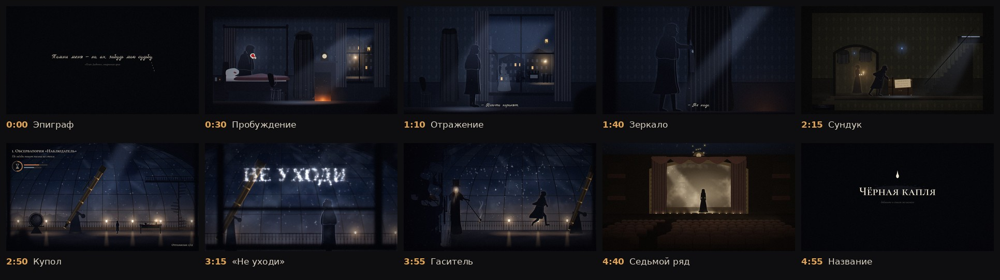

Пять минут читаются как одна дуга: чёрный → холодная синяя спальня → сепия коридора → звёздный купол → чернильная пустота → тёплая сепия театра → чёрный. Тёплые пятна (камин, свеча Мэри, газовые рожки, рампа) ведут глаз, а единственный насыщенный красный — кровь на платке в K1.

---

## K1 · Пробуждение · 0:30

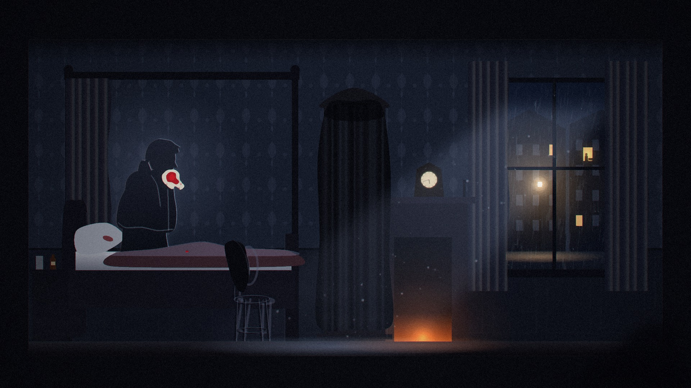

**Композиция.** Спальня в разрезе, как кукольный дом: толстый срез стен и пола обрамляет сцену. Слева кровать с балдахином, в центре завешенное крепом трюмо, справа камин и окно в дождь. Герой в левой трети, под светлым пятном на стене, чтобы силуэт читался.
**Свет.** Ключ — холодная луна из окна, косой полосой через комнату. Заполняющий — угли камина. На стене за героем лунный блик: по правилу «тон фона за героем контрастен».
**Откровенность.** Платок с алой кровью — единственный насыщенный цвет кадра. Тёмное пятно на подушке, капля на одеяле. На тумбочке стакан, ложка и пузырёк лауданума.
**Улики.** Часы на камине стоят на 17:42. Стул у кровати пуст, но «качается»: он дан двойной экспозицией. В окне напротив горит окно, и в нём силуэт у кровати. В правом нижнем углу, в расфокусе, едва угадывается плечо женщины — наблюдательницы.

## K2 · Отражение · 1:10

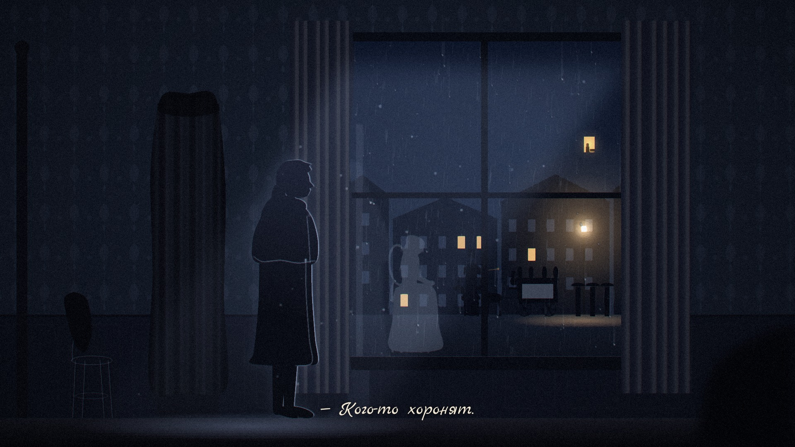

**Композиция.** Герой у окна, крупнее, в левой трети. Окно занимает правую половину кадра и работает как второй экран.
**Главное.** В стекле отражается стул, и на нём сидит женщина в трауре. В комнате, в левой части кадра, этот же стул пуст. Игрок видит обе картинки одновременно и замечает несовпадение сам.
**Фон.** Под дождём проезжает катафалк с плюмажами, рядом идёт фонарщик (Гаситель в мире живых). В доме напротив освещённое окно.
**Интерфейс.** Субтитр её почерком: «— Кого-то хоронят.»

## K3 · Зеркало · 1:40

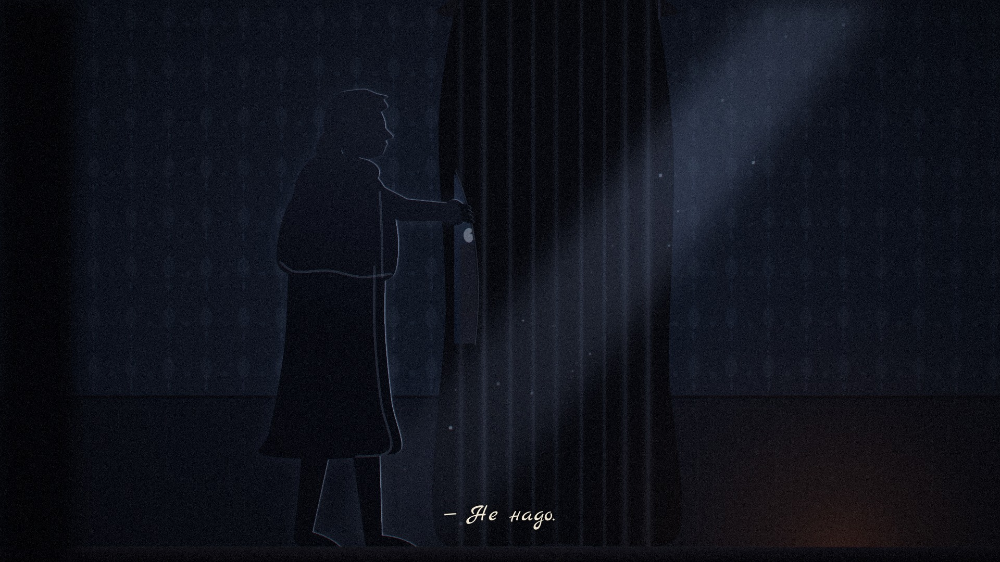

**Композиция.** Низкая камера, зеркало под крепом нависает над героем на всю высоту кадра. Рука сжимает край ткани.
**Свет.** Узкая лунная полоса по диагонали через креп и руку. Тёплый отсвет углей снизу справа. Почти полная тьма.
**Улика.** В щели приподнятого крепа видно стекло, и в нём что-то бледное смотрит в ответ: глаз и край лица. Это её отражение, на один кадр.
**Интерфейс.** Шёпот за спиной игрока, субтитр её почерком: «— Не надо.»

## K4 · Сундук · 2:15

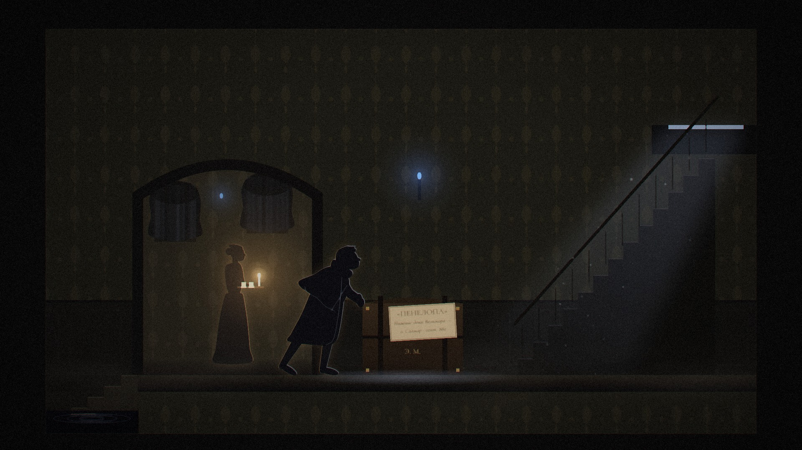

**Композиция.** Лестничная площадка в разрезе. Герой толкает плечом дорожный сундук. Справа узкая лестница поднимается к люку на крышу, слева ступени уходят вниз, в чёрную воду с кругами.
**Свет.** Холодный звёздный свет падает из люка. Газовый рожок прикручен до синего огонька. В арке тёплая свеча горничной.
**Фон.** В арке коридора Мэри несёт поднос с двумя чашками и свечой. Портреты на стенах затянуты крепом.
**Улика.** Ярлык на сундуке: «„Пенелопа“. Нижние доки Вельмора — о. Солмар · сент. 882». Ярлык чистый: сундук никуда не ездил.

## K5 · Купол · 2:50

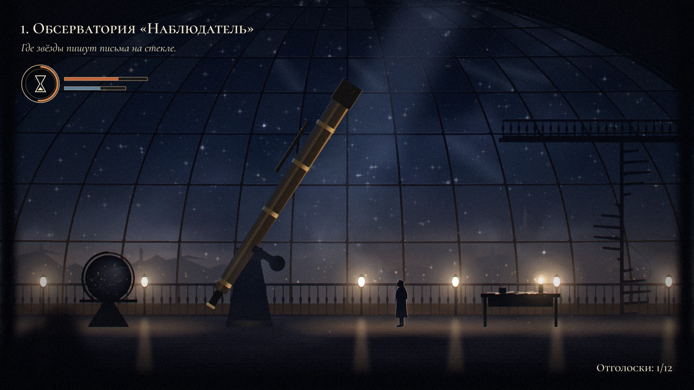

**Композиция.** Обзорный план, герой занимает около 12% высоты кадра. Чугунные рёбра купола, латунный рефрактор на колонне, винтовая лестница к верхней галерее, небесный глобус, стол астронома со свечой и бумагами.
**Свет.** Холодный столб звёздного света из открытой щели купола падает на телескоп. Газовые рожки по галерее дают тёплые пятна и отражения на полу. Герой освещён с двух сторон: тёплый контровой от рожка, холодный от неба.
**Мир.** Над Вельмором почти всегда облака. Чистое звёздное небо в этом кадре — идеализация памяти: так она хочет помнить его купол.
**Интерфейс.** Появление адаптивного HUD: заголовок главы, брошь с песочными часами, полосы «Нить» и «Свет», счётчик «Отголоски: 1/12».

## K6 · «НЕ УХОДИ» · 3:15

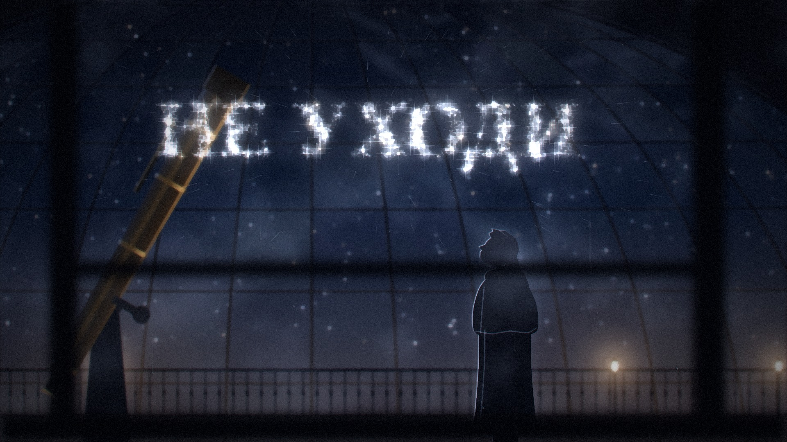

**Композиция.** Стекло на переднем плане, между камерой и героем. Рамы размыты, на стекле конденсат и капли. Звёзды собрались в слова «НЕ УХОДИ»: для игрока читаются, для героя зеркальны. Отдельные звёзды ещё летят на место.
**Свет.** Свет букв падает на лицо героя снизу и спереди: контровой по профилю. Фон — купол и рожки в расфокусе.
**Смысл.** Надпись сделана со стороны камеры. Камера — это она.

## K7 · Гаситель · 3:55

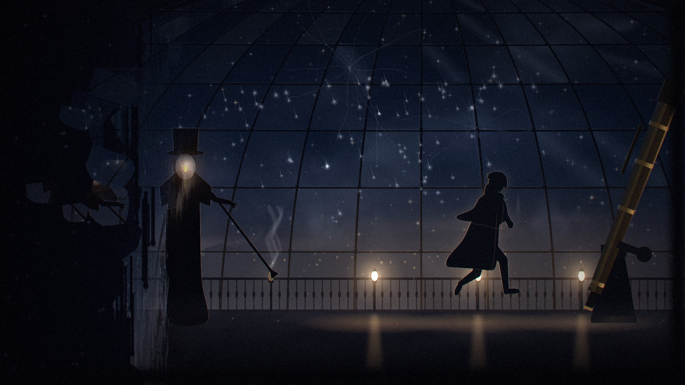

**Композиция.** Длинная галерея. Слева Гаситель гасит рожок: шест с колпачком на плафоне, от погасшей лампы поднимается дым. Справа герой бежит к телескопу и оглядывается. Буквы «НЕ УХОДИ» падают звёздами из трещин в стекле.
**Эффект стирания.** Левый край мира стекает вниз, как мокрая краска, обнажая чернильную пустоту со звёздами. Обрывки купола и перил плавают в пустоте. Так в игре выглядит работа «метода Леты».
**Существо.** Вместо лица у Гасителя плафон матового стекла с фитилём внутри. Погасив лампу, он «съедает» свет: фитиль вспыхивает.

## K8 · Седьмой ряд · 4:40

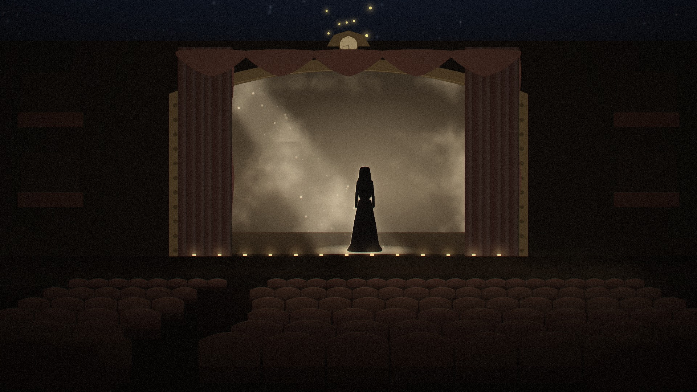

**Композиция.** Взгляд с седьмого ряда, двенадцатого места: ряды пустых кресел ведут к сцене. По краям кадра в расфокусе подлокотники нашего кресла.
**Свет.** Единственный прожектор сверху слева, пыль в луче, рампа по краю сцены. Задник с нарисованными облаками.
**Фигура.** Женщина в глубоком трауре спиной к нам, начинает поворачивать голову.
**Улики.** Над порталом часы стоят на 17:42. На краю расписного потолка перевёрнутый Орион, ошибка её отца, с которой начался их роман. Кресла и занавес приглушены до ржавчины, потому что насыщенный красный зарезервирован за кровью.

## K0 · Персонажи демо

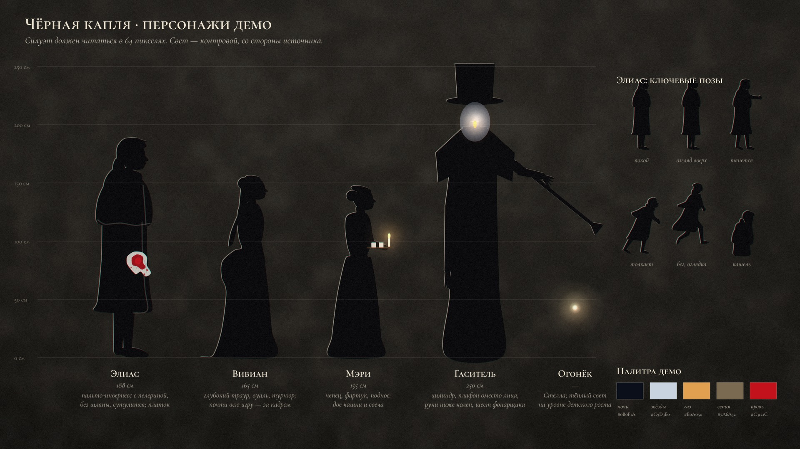

Силуэты в масштабе по сетке в сантиметрах: **Элиас** 188 см (пальто-инвернесс с пелериной, без шляпы, сутулится), **Вивиан** 165 см (глубокий траур, вуаль, турнюр), **Мэри** 155 см (чепец, фартук, поднос с двумя чашками и свечой), **Гаситель** 250 см (цилиндр, плафон вместо лица, руки ниже колен, шест фонарщика), **Огонёк** (дочь, тёплый свет на уровне детского роста). Справа шесть ключевых поз героя из демо. Внизу палитра демо.

### Служебные кадры

| Эпиграф · 0:00 | Название · 4:55 |
|---|---|
| 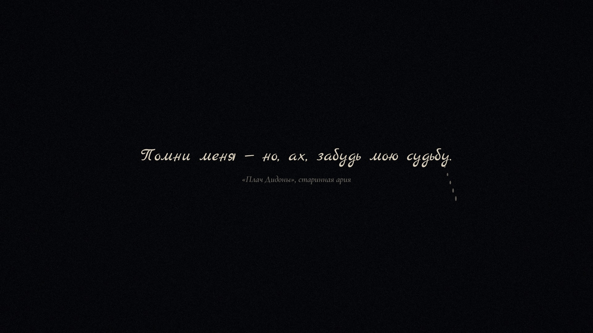 | 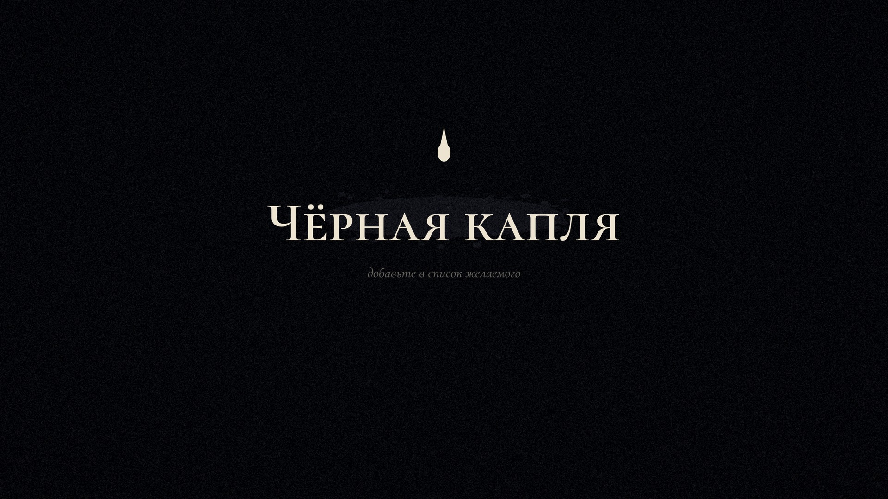 |

---

## Что концепт-художник не должен менять
1. **Масштаб и место героя** в кадре (левая или правая треть, 10–14% высоты в игровом кадре, ~12% в K5).
2. **Направление и тип ключевого света** в каждом кадре: луна из окна, звёзды из щели, свеча, прожектор.
3. **Улики:** часы на 17:42, пустой стул против стула в отражении, ярлык сундука, буквы со стороны камеры, перевёрнутый Орион, силуэт наблюдательницы в расфокусе.
4. **Правило красного:** насыщенный красный есть только у крови.
5. **Силуэты персонажей** с листа K0.

## Что художник добавляет
Фактуру и детализацию: лепнину, дерево, бархат, ржавчину, стекло с пузырями, лица и руки на крупных планах, живописную моделировку объёмов, более сложную архитектуру купола и театра. Ориентир по поверхности — присланные макеты локаций.

## Промпты для доработки кадров в генераторе изображений

Используйте кадр как **image prompt / reference** (img2img, сила изменения 0,35–0,5), чтобы сохранить композицию и свет, и добавьте текст:

```
K1 — painterly 2.5D side-view game concept art, cross-section of a gaslamp-era bedroom like a dollhouse,
gaunt man in a long dark Inverness coat sitting up on a canopy bed coughing bright red blood into a white
handkerchief (the only saturated colour), dark wine blanket, shrouded mirror under black mourning crepe,
mantel clock stopped at 17:42, rain-streaked window with a night street, cold moonlight shaft, dying embers,
dust motes, muted indigo palette, Inside and Little Nightmares mood, oil painting texture, 16:9
```
```
K2 — same bedroom, man standing at a tall rain-streaked window, in the glass a translucent reflection of a woman
in black mourning dress sitting on a bentwood chair, while the real chair in the room is empty, outside a black
horse-drawn hearse with plumes passes under a street lamp, a very tall lamplighter with a top hat, painterly, cold blue
```
```
K5 — wide shot of a glass-domed rooftop observatory at night in a fictional gaslamp city, cast-iron ribs,
brass refracting telescope on a pier, celestial globe, astronomer's desk with a candle, spiral iron stair,
gas lamps along a railing, column of cold starlight from the open dome slit, tiny silhouette of a man in a
long coat, oil painting, melancholic, cinematic
```
```
K7 — 2.5D side-view chase, very tall thin lamplighter in a top hat whose face is a frosted glass lamp globe
with a glowing wick, snuffing a gas lamp with a brass pole, smoke curling, behind him the painted world runs
down like wet oil paint into a black ink void with stars and floating torn fragments, a man in a long coat
running away toward a telescope, falling stars, painterly, eerie
```
```
K8 — point of view from row seven of an empty decayed theatre, rows of worn rust-velvet seats, dull gilded
proscenium with a stopped clock at 17:42, painted cloud backdrop, single dusty spotlight on a woman in black
Victorian mourning dress with a veil standing with her back to us, starting to turn her head, footlights,
sepia palette, painterly, haunting
```

## Как перерисовать кадр

```bash
cd tools/concept
PWPATH=/путь/к/playwright node render.js ../../out/raw K5      # canvas → PNG 2880×1620
python3 post.py ../../out/raw ../../docs/concept K5            # масло, блум, зерно, грейдинг → JPG 1920×1080
```
Сцены описаны в `tools/concept/scenes.js`, общие инструменты (свет, туман, силуэты, реквизит) — в `tools/concept/lib.js`, постобработка и грейдинг по кадрам — в `tools/concept/post.py`.
