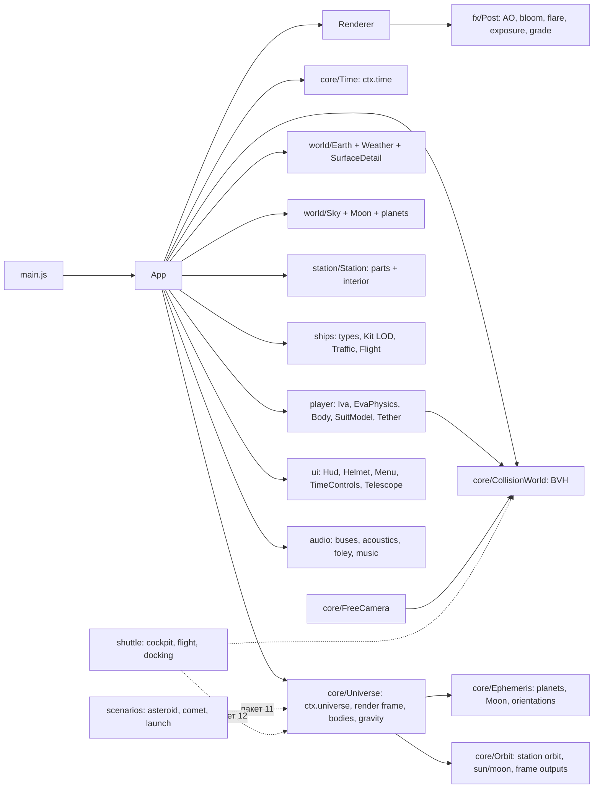
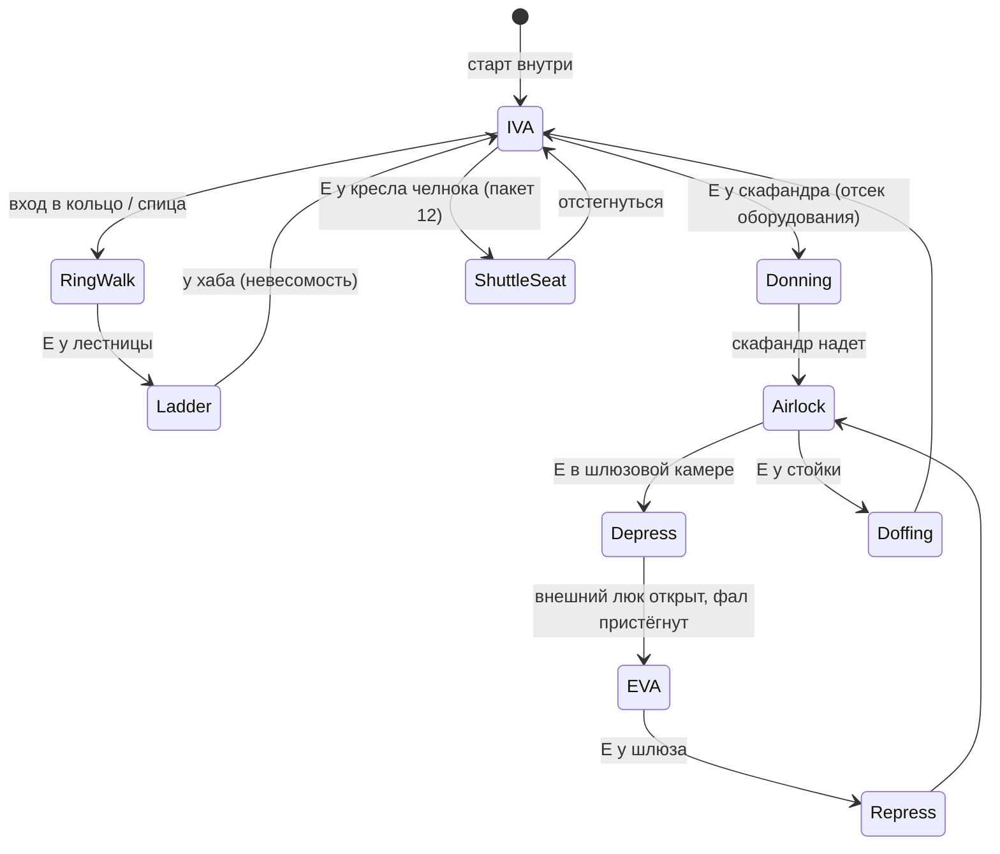

# Схемы

## 1. Модули и зависимости



## 2. Кадр

```mermaid
sequenceDiagram
  participant L as App._loop
  participant T as ctx.time
  participant U as ctx.universe
  participant M as модули
  participant R as Renderer/Post
  L->>T: tick(realDt) → dt (с учётом скорости/паузы)
  L->>U: setFrame (станция / свободная камера / челнок) → update()
  U->>U: орбита станции, Солнце/Луна, тела → выходы в рендер-кадре
  L->>M: update(dt): Earth, Sky, Station(+interior), Ships, Player, Hud, Audio
  L->>R: far pass (км; 1–2 среза глубины) → clear depth → near pass (м) → AO → bloom → flare → grade → вывод
  L->>L: регулятор качества (окна 0,5 с, таймер GPU)
```

## 3. Системы координат

```
ECI (км, double)  ── истина для орбит: станция, корабли, челнок, астероид, комета, Луна
   │  render frame = (originEci, axes)   по умолчанию: станция + LVLH (как было)
   ▼
far scene (км) ── Земля в orbit.earthCenterFar, Луна/тела через universe.addBody
near scene (м) ── universe.stationRoot: станция, корабли, игрок (station frame = LVLH станции)
                   кольцо: своя вращающаяся система (ring frame) для ходьбы и интерьера
LVLH: +X по скорости, +Y от Земли (зенит), +Z = X × Y
```

## 4. Состояния игрока



## 5. Шлюзование (давление)

```
Отсек оборудования 101 кПа ─ внутренний люк ─ Шлюзовая камера: 101 → 70 → 34 → 0 кПа ─ внешний люк ─ вакуум
звук в камере затухает вместе с давлением; в скафандре слышно только через конструкцию и радио
```

## 6. Челнок: полёт (пакет 12)

```mermaid
stateDiagram-v2
  [*] --> Docked
  Docked --> Undock: команда «Расстыковка» (крюки, пружины 0,1 м/с)
  Undock --> Departure: отход по коридору (RCS), > 200 м
  Departure --> Free: свободный полёт (RCS, ОМД, удержание ориентации)
  Free --> Burn: манёвр (разгон/торможение), перегрузка в кабине
  Burn --> Free
  Free --> Approach: «Сближение» (ось порта, индикаторы коридора)
  Approach --> Contact: касание < 0,1 м/с, рассогласование < 0,1 м / 1°
  Contact --> Docked: захват, стягивание, защёлки
  Free --> TLI: разгон к Луне (Δv ≈ 3,1 км/с)
  TLI --> Coast --> LOI: торможение у Луны (Δv ≈ 0,9 км/с)
  LOI --> LunarOrbit
  Free --> Crash: столкновение > порога (повреждения, разгерметизация, взрыв)
```

## 7. Сценарий «запуск → стыковка → посадка» (пакет 11)

```
T−0      старт с Байконура (46° с. ш.) в плоскости орбиты станции; станция пролетает рядом — виден факел
T+2:00   отделение боковых блоков 1-й ступени (кольцо «Корролёв-крест»), T+4:45 — 2-я ступень, обтекатель
T+8:48   выведение на орбиту 200×240 км, раскрытие батарей и антенн
~3 ч     быстрая схема сближения (2 витка), импульсы коррекции, зависание 150 м, причаливание, стыковка
+N суток расстыковка (по ускоренному времени), тормозной импульс, разделение отсеков,
         вход в атмосферу (плазма), парашют, посадка в Казахстане рядом с местом старта
```
