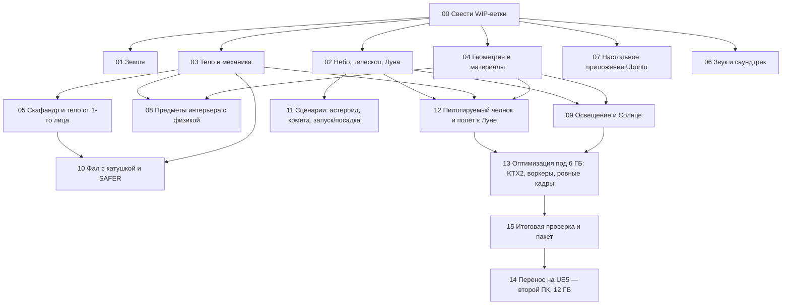

# Дорожная карта: пакеты работ

Каждый пакет имеет промпт в `prompts/NN-*.md`. Колонка «Можно параллельно с» показывает, какие пакеты не
пересекаются по файлам.

| № | Пакет | Владеет файлами | Можно параллельно с | Ориентир |
|---|---|---|---|---|
| 00 | Свести WIP-ветки в основную линию | все (по очереди) | — | 1 сессия |
| 01 | Земля: доводка детализации и ночи | `src/world/Earth*`, `Weather.js`, `SurfaceDetail.js`, `shaders/*`, `public/textures/earth` | 02, 03, 04, 06, 07 | 1–2 |
| 02 | Небо, телескоп, Луна для низкой орбиты | `src/world/Sky*`, `Moon*`, `src/core/Ephemeris.js`, `src/ui/Telescope*` | 01, 03, 04, 06, 07 | 1–2 |
| 03 | Тело 1,8 м, коллизии, авто-действия | `src/player/*` (кроме SuitModel), `src/core/CollisionWorld.js` | 01, 02, 04, 06, 07 | 1–2 |
| 04 | Геометрия без зазоров, материалы, стёкла | `src/station/**`, `src/ships/**`, Materials/Textures | 01, 02, 03, 06, 07 | 2–3 |
| 05 | Скафандр + тело от 1-го лица (в скафандре и без) с IK | `src/player/SuitModel.js`, `src/player/suit/**`, `Body*.js`, скафандры в шлюзе | 06, 07 | 2 |
| 06 | Звук и саундтрек | `src/audio/**`, `public/audio/**` | все | 1–2 |
| 07 | Настольное приложение (Electron) для Ubuntu | `desktop/**`, скрипты package.json | все | 1 |
| 08 | Предметы интерьера сложной формы с физикой | `src/station/interior/props/**`, физика предметов | 06, 07, 11 | 2 |
| 09 | Освещение (RTX 3060) и реалистичное Солнце | `src/fx/*`, свет в App, свет интерьеров | 06, 07, 11 | 2 |
| 10 | Фал с катушкой и маневровые клапаны SAFER | `src/player/Tether*`, `EvaPhysics.js`, HUD скафандра | 06, 07, 09, 11 | 1–2 |
| 11 | Сценарии: астероид, комета, запуск → стыковка → посадка | `src/scenarios/**`, тела в `ctx.universe` | 06–10 | 2–3 |
| 12 | Пилотируемый челнок: кабина, кресло, полёт, стыковка, Луна, повреждения | `src/shuttle/**` | 06, 07, 11 | 3–4 |
| 13 | Оптимизация без просадок под 6 ГБ | загрузчики, `tools/`, воркеры | — | 1–2 |
| 14 | Перенос на Unreal Engine 5 (второй ПК, 12 ГБ) | новый репозиторий | — | много |
| 15 | Итоговая проверка, документация, сборки | всё | — | 1 |

«Ориентир» — примерное число полноценных сессий агента.

## Принципы, которые нельзя потерять

1. **Реализм прежде эффектов.** Физические единицы, реальные данные, реальные пропорции, правильная физика
   (вакуум, невесомость, вращение кольца с Кориолисом, орбитальная механика).
2. **Цельность.** Без зазоров, тонких «картонных» стенок и плавающих деталей. Всё закреплено, всё имеет толщину.
3. **Ощущение тела.** Движения передают силу и инерцию; игрок задаёт намерение, тело выполняет действие
   (схватиться, оттолкнуться, затормозить).
4. **60 fps в 1080p на RTX 3060 6 ГБ.** Детализация через LOD и дальность, а не за счёт кадров.
5. **Русский интерфейс**, понятные подсказки, атмосфера «космического величия и меланхолии».
